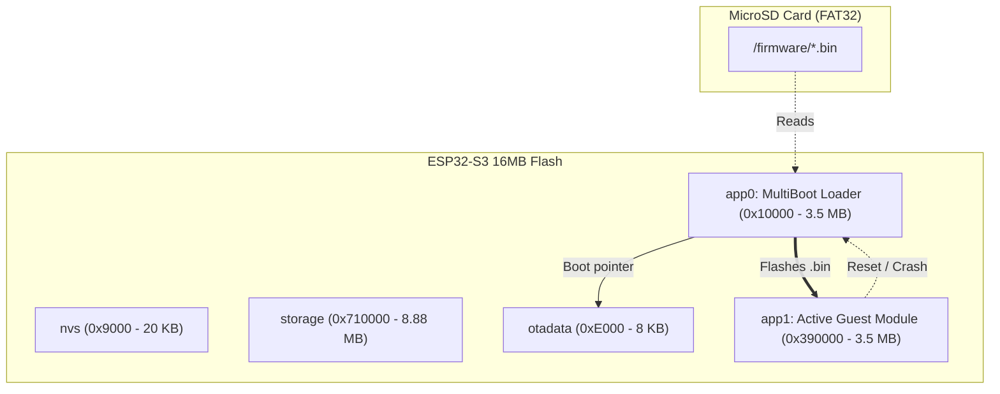
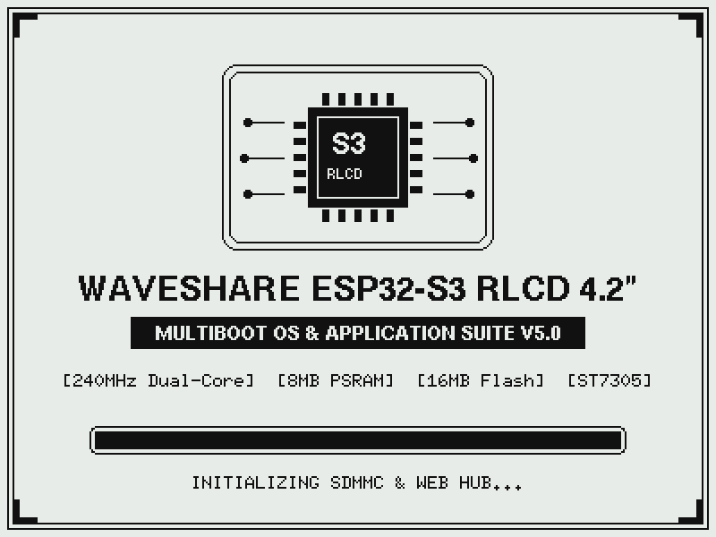
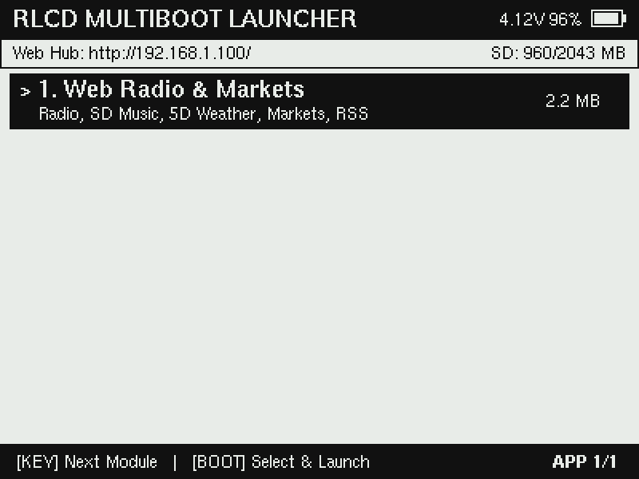
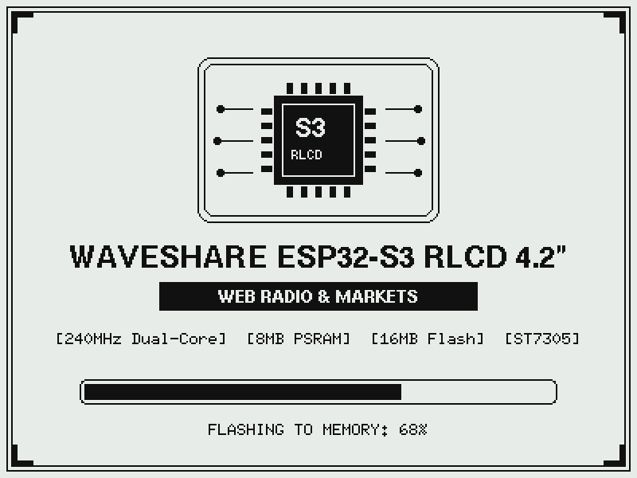
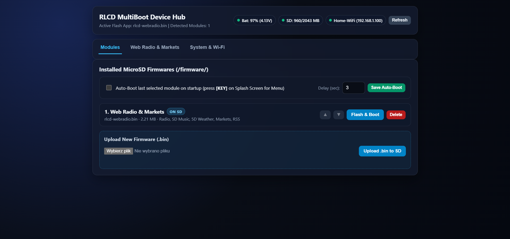

# Waveshare ESP32-S3 4.2″ RLCD MultiBoot Loader

[](https://github.com/v3n0m3n0/Waveshare-ESP32-S3-RLCD-MultiBoot-Loader/releases/tag/v1.0.0)
[](LICENSE)
[](https://www.waveshare.com/wiki/ESP32-S3-RLCD-4.2)
[](https://www.waveshare.com/wiki/ESP32-S3-RLCD-4.2)
[](platformio.ini)

An autonomous, production-grade **MultiBoot Loader, Dual-OTA firmware manager, and embedded Web Device Hub** tailored specifically for the **Waveshare / Luckfox ESP32-S3 4.2″ Reflective LCD (RLCD) Development Board** (`ESP32-S3-WROOM-1-N16R8`, ST7305 monochrome reflective display, 1-bit `400×300`, MicroSD via SDMMC, Octal PSRAM).

The MultiBoot Loader resides permanently in partition `app0`. It indexes firmware binaries stored on the MicroSD card (`/firmware/*.bin`), writes the selected application into partition `app1` in seconds, and provides a guaranteed physical reset mechanism that safely returns the device to the launcher menu at any time.

---

## Architecture & Ecosystem Notice

> [!IMPORTANT]
> **Standalone Repository Architecture:**
> This repository is dedicated **exclusively to the MultiBoot Loader (`app0`)**.
> Functional application modules (such as Web Radio, Retro Emulators, Dashboards, and Sensors) are independently developed, versioned, and published in their own dedicated GitHub repositories.



### Supported Application Modules

Every compliant application compiles to an independent binary image targeted for `app1` (`0x390000`) and resets the OTA boot pointer to `app0` upon startup.

| Application Module | Description | Repository | Status |
|---|---|---|---|
| **Web Radio & Markets** | High-fidelity Web Radio (ES8311 I2S DAC, ESP32-audioI2S v3), LRCLIB synchronized lyrics, Open-Meteo 5-day weather, NBP & Binance market trend sparklines, SHTC3 climate sensing, and RSS headlines. | [`v3n0m3n0/Waveshare-ESP32-S3-RLCD-WebRadio-Markets-Module`](https://github.com/v3n0m3n0/Waveshare-ESP32-S3-RLCD-WebRadio-Markets-Module) | [](https://github.com/v3n0m3n0/Waveshare-ESP32-S3-RLCD-WebRadio-Markets-Module/releases/tag/v1.0.0) Available |
| **Game Boy Color & DMG** | Full-speed Game Boy / GBC emulator with audio synthesis, save states, multi-palette RLCD rendering, on-device ROM selector, and button mapping. | [`v3n0m3n0/Waveshare-ESP32-S3-RLCD-GameBoy`](https://github.com/v3n0m3n0/Waveshare-ESP32-S3-RLCD-GameBoy) *(Upcoming)* | Completed & Verified |

### Developing Compatible Custom Modules
Any ESP-IDF or Arduino-ESP32 project can be deployed via MultiBoot Loader by adhering to two rules:
1. **Partition Table:** Build with a partition table providing an application slot of at least `3.5 MB` (matching `app1`).
2. **Reboot Guard Contract:** Add this snippet at the very beginning of your `setup()` function:
   ```cpp
   #include <esp_ota_ops.h>
   const esp_partition_t *launcher = esp_partition_find_first(ESP_PARTITION_TYPE_APP, ESP_PARTITION_SUBTYPE_APP_OTA_0, NULL);
   if (launcher) esp_ota_set_boot_partition(launcher);
   ```

---

## Visual Overview

| Boot Splash Screen | Launcher Menu & Battery Gauge |
| :---: | :---: |
|  |  |
| *ESP32-S3 silicon crest & hardware initialization* | *Firmware list, negative double-outlined battery gauge & auto-boot* |

| OTA Flashing Progress | Web Device Hub (Port 80) |
| :---: | :---: |
|  |  |
| *High-speed flashing from MicroSD into `app1` (`0x390000`)* | *Firmware manager, reordering (`▲`/`▼`), `.bin`/`.gb` upload & Wi-Fi* |

---

## Key Features

- **Dual-OTA Non-Volatile Safety:** Partition `app0` is permanently locked to the MultiBoot Loader. Flashing guest modules into `app1` never risks bricking the bootloader.
- **Negative Double-Outlined Battery Gauge:** Precision ADC monitoring with analog filtering, rendering an inverted double-bezel battery gauge (`voltage + %`) on the top status bar.
- **Persistent Firmware Reordering via WebUI:** Web Manager controls (`▲` / `▼`) allowing users to sort firmware slots, persistently stored in NVS (`"launcher"` namespace).
- **Configurable Auto-Boot Countdown:** Automatic startup timer that launches the default firmware unless interrupted by pressing `[KEY]`, `[BOOT]`, or sending a serial command.
- **Unified Graphical Splash Screen:** Clean technical boot and flashing screen featuring an ESP32-S3 silicon package crest, technical specifications, and animated progress bar.
- **Fast SDMMC 1-Bit Peripheral Driver:** 40 MHz 1-bit SDMMC bus reading `/firmware/*.bin` files and ROMs in milliseconds.
- **Responsive Web Device Hub:** Embedded web server on port 80 with one-click flashing, direct `.bin` firmware and `.gb`/`.gbc` ROM uploading, file deletion, and Wi-Fi credential management.
- **Physical Buttons & USB-CDC Control:** On-device navigation with `[KEY]` (cursor cycle) and `[BOOT]` (launch/flash), accompanied by interactive serial console commands (`STATUS`, `BOOT <name>`, `SDLIST`, `BATTERY`, `LAUNCHER`).

---

## Hardware Pinout (ESP32-S3-WROOM-1-N16R8)

Authoritative pin definitions are defined in [`include/board_pins.h`](include/board_pins.h):

| Subsystem | Signal | GPIO | Runtime Notes |
|---|---|---|---|
| **ST7305 RLCD (400×300)** | `SCK` / `MOSI` / `DC` / `CS` / `RST` | `11` / `12` / `5` / `40` / `41` | SPI bus; U8g2 driver (`U8G2_R1` landscape) |
| **MicroSD Slot** | `CLK` / `CMD` / `D0` | `38` / `21` / `39` | High-speed 1-bit SDMMC peripheral |
| **Buttons** | `BOOT` / `KEY` | `0` / `18` | Active LOW with software debounce |
| **Battery ADC** | `BAT_ADC` | `4` | `ADC1_CH3` resistor divider |
| **Audio Amp (PA)** | `PA_ENABLE` | `46` | Digital output; held LOW (muted) in launcher |
| **I²C Sensor Bus** | `SDA` / `SCL` | `15` / `16` | SHTC3 climate sensor, PCF85063 RTC, ES8311 codec |

---

## Flashing Prebuilt Release (`v1.0.0`)

Prebuilt binaries for the official release live in [`release/`](release/) (see [`release/README.md`](release/README.md) for cryptographic SHA-256 sums and partition offsets).

### Option A: Automated Windows Flasher (Recommended)
Download the repository or release archive, plug your device via USB-C, and run:
```powershell
.\release\flash.ps1 -Port COM11
```
Or double-click `release\flash.bat` and enter your COM port.

### Option B: Unified Factory Flash (`0x0`, 16 MB Image)
For a fresh or completely erased board, flash the merged 16 MB factory image:
```sh
python -m esptool --chip esp32s3 --port COM11 --baud 921600 \
  --before default-reset --after watchdog-reset write_flash \
  --flash_mode qio --flash_size 16MB --flash_freq 80m \
  0x0 release/waveshare-esp32s3-rlcd-multiboot-loader-full-16MB-v1.0.0.bin
```

> **Note on ESP32-S3 USB-Serial-JTAG Reset:** The provided flash scripts automatically pass `--after watchdog-reset` (requires `esptool >= v4.7`) so the ESP32-S3 safely exits ROM download mode and boots the firmware immediately.

---

## Building from Source

### Prerequisites
- [PlatformIO Core (CLI)](https://platformio.org/) or PlatformIO IDE extension in VS Code.

### Compilation
```bash
# Clone the repository
git clone https://github.com/v3n0m3n0/Waveshare-ESP32-S3-RLCD-MultiBoot-Loader.git
cd Waveshare-ESP32-S3-RLCD-MultiBoot-Loader

# Build firmware binary using PlatformIO
pio run -e esp32-s3-rlcd-launcher

# Upload directly to ESP32-S3 via USB-CDC
pio run -e esp32-s3-rlcd-launcher -t upload --upload-port COM11
```

---

## Documentation Links
- [**User & Configuration Guide (`docs/guide.md`)**](docs/guide.md)
- [**Release Notes (`RELEASE_NOTES.md`)**](RELEASE_NOTES.md) & [**`v1.0.0` Details**](docs/releases/v1.0.0.md)
- [**Release Policy (`RELEASE.md`)**](RELEASE.md)
- [**Developer & AI Architecture Guide (`AGENTS.md`)**](AGENTS.md)

---

## License & Attribution

- **License:** GNU General Public License v3.0 (`GPL-3.0`). See [`LICENSE`](LICENSE) and [`NOTICE`](NOTICE).
- **Author:** Kamil Brokowski ([@v3n0m3n0](https://github.com/v3n0m3n0)).
